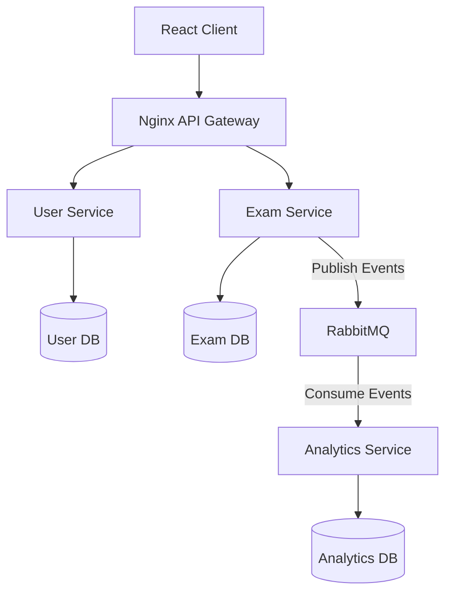

# Whatsapp-quiz-app

A microservices-based quiz application inspired by the WhatsApp quiz experience. Users can attempt quizzes while the system collects analytics such as learning velocity, question difficulty, and fatigue analysis.

The project demonstrates:
- Microservices Architecture
- Event-driven communication using RabbitMQ
- API Gateway using Nginx
- Docker Compose orchestration
- MongoDB databases
- React frontend

## Architecture
The application follows a microservices architecture to improve scalability, maintainability, and separation of concerns. The core business logic (user management and quiz operations) is separated from the analytics engine because analytics workloads differ significantly from quiz operations. This allows each service to scale independently based on demand.
Services communicate asynchronously through RabbitMQ. Whenever a user submits an answer, an event is published to RabbitMQ. The Analytics Service consumes these events, processes them independently, and stores analytical data without affecting quiz response times.

## Architecture Diagram



## Database Design
Each microservice owns its own database to maintain loose coupling and service independence.

- **User DB** – Stores user profiles and authentication data.
- **Exam DB** – Stores exams, subjects, chapters, questions, and user attempts.
- **Analytics DB** – Stores processed analytics generated from quiz events.

### Exam DB
In this DB there are 4 collections:
* exams
* subjects
* chapters
* questions
* question_attempts

So basically exams has subjects, subjects has chapters, chapters has questions and questions will be attempted by the user. And question_attempts will store the attempts of the user for the questions with some metadata.

### Client
The frontend is built using React.js and Tailwind CSS. It provides an interface for users to browse exams, attempt quizzes, and view analytical insights.

### Server
So the server will be a simple API gateway which will be used to route the requests to the appropriate service using the Nginx configuration with the help of docker-compose network. 

Nginx acts as the API Gateway for the system.

Responsibilities include:

- Routing requests to the appropriate microservice
- Providing a single entry point for clients
- Simplifying service discovery within the Docker network
- Abstracting internal service URLs

#### We have 3 services:
1. User Service- This service will handle all the user related operations.
2. Exam Service- This service will handle all the exam related operations.
3. Analytics Service- This service will handle all the analytics related operations.

## Prerequisites
1. Docker

## Getting Started
1. First run the ```docker compose up --build -d``` in the root directory
2. Then run the seed_microservices.py script using ``` python3 seed_microservices.py``` inside the **server/quiz_analytics_backend directory**, where this script is present, this script will seed the database with the initial data.
3. Frontend will launch on - ```http://localhost:5174``` 

## Ports
| Service | Port |
|---------|------|
| Frontend | 5174 |
| API Gateway | 80 |
| RabbitMQ | 5672 |
| RabbitMQ Dashboard | 15672 |

## Endpoints

```http request
// Exams 
POST   /api/v1/exams
GET    /api/v1/exams
GET    /api/v1/exams/{exam_id}

// Subject
POST   /api/v1/subjects
GET    /api/v1/exams/{exam_id}/subjects
GET    /api/v1/subjects/{subject_id}

// Chapter
POST   /api/v1/chapters
GET    /api/v1/subjects/{subject_id}/chapters
GET    /api/v1/chapters/{chapter_id}

// Question
GET    /api/v1/chapters/{chapter_id}/questions
GET    /api/v1/subjects/{subject_id}/questions
GET    /api/v1/exams/{exam_id}/questions
GET    /api/v1/questions/{question_id}

// Analytics
GET    /api/v1/analytics/learning-velocity
GET    /api/v1/analytics/fatigue-analysis?user_id={user_id}
GET    /api/v1/analytics/question-difficulty
```

## Future Enhancements

- Introduce primary-replica database replication to improve read scalability.
- Add Redis caching for frequently accessed quiz data.
- Implement JWT-based authentication and role-based authorization.
- Deploy services using Kubernetes.
- Add distributed tracing and centralized logging.
- Introduce CI/CD pipelines.
- Support horizontal autoscaling for individual services.
